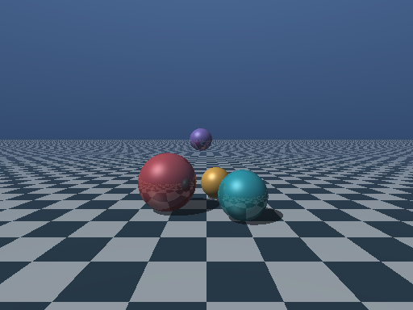
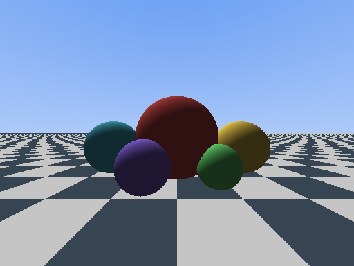

# NIL Framework

NIL is an open-source programming language framework for systems and application
development. It brings together **Ny**, with its compact systems syntax, and
**Matrix**, which expresses the same programming model in structured prose.
Both languages share a type system, standard library, and runtime. Programs
can run in the NIL virtual machine or compile to native code through LLVM.

This repository contains the compiler, runtime, standard library, debugger,
and editor tools for both languages.

[Documentation](docs/README.md) · [Getting started](docs/getting-started/index.md) ·
[Ny](ny/README.md) · [Matrix](matrix/MATRIX-GUIDE.md) ·
[Contributing](CONTRIBUTING.md)

## Ny and Matrix

### Ny

Ny uses familiar function declarations, explicit types, and symbolic operators.
It combines records, classes, and generic programming with direct control over
pointers and allocation.

```ny
fn squared_length(x: i64, y: i64) -> i64
    return x * x + y * y
end fn

fn main() -> i32
    println(squared_length(3, 4))
    return 0
end fn
```

### Matrix

Matrix uses declarations that read as sentences, named arguments, and operators
written as words. Its grammar is designed for human readers and code-generating
agents, with explicit types and direct control over memory.

```matrix
book example

squared-length receives x as number, y as number returns number begin paragraph
    give x times x plus y times y
end paragraph

main returns override integer begin paragraph
    say squared-length with x being 3, y being 4
    give 0
end paragraph
```

Both programs print `25`. Save the Ny example as `example.ny`, or the Matrix
example as `example.matrix`. Matrix also accepts the `.mat` extension.

The [Ny language reference](docs/language-reference/types.md) and
[Matrix guide](matrix/MATRIX-GUIDE.md) cover the syntax and programming model.
The [Matrix design notes](matrix/README.md) explain the rationale behind its
grammar.

## The framework

Ny and Matrix compile through a shared semantic core to **NIL**, a stack-based
intermediate representation. The interpreter executes NIL directly; the native
backend lowers it through LLVM. A common module system lets programs in either
language use libraries written in the other.

The framework includes:

- **Systems programming facilities.** Typed scalar and bitwise operations,
  raw pointers, managed values, checked local ownership of scalar buffers,
  typed faults, and bounded parallel execution.
- **Shared language features.** Structural tuples provide typed multiple
  results and local destructuring. Explicit string interpolation supports
  expressions with consistent scalar formatting across execution routes.
- **A shared standard library.** `nil.std.*` provides collections, text,
  mathematics, binary I/O, diagnostics, and reflection, alongside SQLite and
  PostgreSQL access. Existing `ny.lang.*` imports remain compatible aliases.
- **Interpreted and native execution.** The toolchain supports NIL
  interpretation, LLVM JIT and ahead-of-time compilation, and separate
  assembly and linking through `nilassembler` and `nillinker`.
- **Program analysis and debugging.** Structured diagnostics, declaration
  metadata, and source debugging provide a common basis for editor support
  and analyzers written in Ny or Matrix.
- **Project tooling.** `nilbuild` shares project settings and default analyzer
  rules with VS Code, and checks applications before VM or native builds.
  Live editor analysis includes unsaved source dependencies through a shared
  workspace snapshot. Compiler-resolved source bindings support Go to Definition
  for local variables, parameters and imported functions across both languages.
  Certified local variables also support references and checked rename.
- **Aperture runtime diagnostics.** Memory profiles record runtime allocations,
  frees, retained storage, peaks and source locations for VM and native programs.
  Saved JSON reports support inspection and automated analysis. See
  [aperture/README.md](aperture/README.md) for coverage and planned capabilities.

See the [standard-library reference](docs/standard-library/index.md),
[analysis API](docs/analysis-api.md), and [tool reference](docs/tools/index.md)
for available APIs and commands. The [NIL format documentation](docs/advanced/nil-format.md)
describes executable artifacts and the current library import model.

## Getting started

### Build the SDK

Building on Linux requires a C++17 compiler, CMake 3.21 or later, Python 3.12 or
later, LLVM development packages, and Pandoc. The
[setup guide](docs/getting-started/index.md) lists platform dependencies and
options for database support and builds without LLVM.

```sh
git clone https://github.com/exec-software/exec-nil-framework.git
cd exec-nil-framework
CMAKE_BUILD_PARALLEL_LEVEL=4 CTEST_PARALLEL_LEVEL=4 ./scripts/build-sdk.sh
```

The build runs the test suite and creates an SDK in `sdk/`, including the
compiler, runtime tools, standard library, and HTML documentation. It expects
a clean checkout; see the setup guide for building with local changes.

### Compile and run

Compile the Matrix example to NIL and run it:

```sh
sdk/nilcompiler --no-bundle example.matrix -o example.nil
sdk/nilinterpreter example.nil
```

Or compile it to a native executable:

```sh
sdk/nilcompiler --native example.matrix -o example-native
./example-native
```

Use `example.ny` in the same commands to compile the Ny version. Native linking
uses the host C++ toolchain and the SDK's runtime library.

To check a program and emit structured diagnostics:

```sh
sdk/nilcompiler --analyze example.matrix
```

### Visual Studio Code

The [VS Code extension](vscode/README.md) supports both languages with syntax
highlighting, completion, compiler diagnostics, quick fixes, build tasks, and
source debugging. Follow its installation instructions, then set `ny.sdkPath`
to the SDK directory. The extension also discovers `sdk/` when working in this
repository. Compiler-backed completion includes visible locals, imported functions
and supported receiver members. Signature help follows resolved call parameters,
including Matrix named arguments. Definition navigation follows
checked bindings across both languages; references and rename are available for
locals whose complete occurrence sets the compiler can certify.

For projects with multiple source modules, add a
[`nil.project.json`](docs/tools/projects.md) manifest. Project check, build and
run commands use the same import paths and analyzer policy as live checks.

## Examples

[`validation/ny-3d`](validation/ny-3d) is an independent consumer of the SDK:
three CPU 3D renderers written in Ny, driven by a Python harness that checks
each execution route against an independently written reference. The sphere
scene is compared pixel for pixel against a float64 oracle, including per-row
hashes, so a pass means the Ny program and the oracle agree exactly.



The indexed mesh renderer rasterizes triangles into raw depth buffers:


The third renderer is an animated scene player with reused buffers and an
atomic binary checkpoint. It currently disagrees with its own oracle on both
routes, while the first two agree exactly. That is tracked as a
[known finding](validation/ny-3d/README.md#known-finding-scene-player-disagrees-with-its-oracle),
not a passing case, so `--quick` exits nonzero on four passes and two failures.

Build the SDK, then run the matrix from that directory:

```bash
cd validation/ny-3d
python3 scripts/validate.py --quick
```

The harness covers eight routes — textual and binary NIL through the
interpreter, bundled executables, LLVM JIT, native ahead-of-time, and
assembler/linker — verifies the SDK payload against its sealed manifest before
and after every run, and refuses to execute an SDK that changed underneath it.

[`validation/matrix-3d`](validation/matrix-3d) is the same discipline applied
to a single raytracer written in **Matrix**. It checks every route twice —
against an independent float64 oracle and against every other route — so a pass
means the interpreted and LLVM backends produce byte-identical images that also
match the reference exactly. All eight routes currently do.



It also turned up a real defect: numeric-to-text casts (`say (5 becomes text)`)
compile on all four interpreted routes but are rejected by the LLVM native
backend. The renderer works around it and the
[README](validation/matrix-3d/README.md#known-limitation-number-to-text-casts-on-native-routes)
records the reproduction.

## Project status

The current version is **1.0.0-rc.1**. Linux x86_64 is the validated development
platform; Windows and macOS support is experimental. The
[release profile](docs/release/v1-profile.md) defines supported configurations
and release requirements. Known limitations and planned improvements are
tracked in the [development findings](matrix/docs/next-version-findings.md).

## Contributing

NIL is developed by Execute Software and its [contributors](CONTRIBUTORS.md).
Community contributions are welcome across the languages, compiler, runtime,
standard library, documentation, and developer tools.

Start with [CONTRIBUTING.md](CONTRIBUTING.md) for the build and test workflow.
Use the [issue tracker](https://github.com/exec-software/exec-nil-framework/issues)
to report bugs or propose changes. Bug reports should include a small program
that reproduces the problem and the commands used to build or run it.

Architectural decisions are recorded in the [design index](docs/design/README.md):
`NIL-` for the shared framework, `NY-` for Ny, and `MAT-` for Matrix.

## License

NIL Framework is licensed under the [MIT License](LICENSE).

Copyright (C) 2008 - 2026 Execute Software.  All rights reserved.

Third-party components retain their own licenses. See the
[toolchain notices](release/THIRD_PARTY_NOTICES.txt) and
[extension notices](vscode/THIRD_PARTY_NOTICES.txt).
