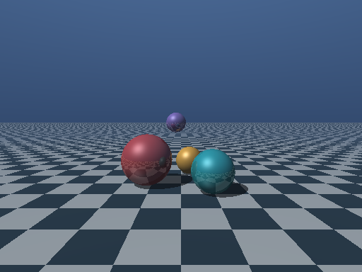
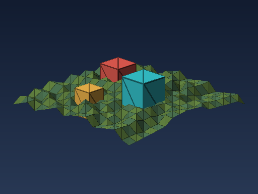
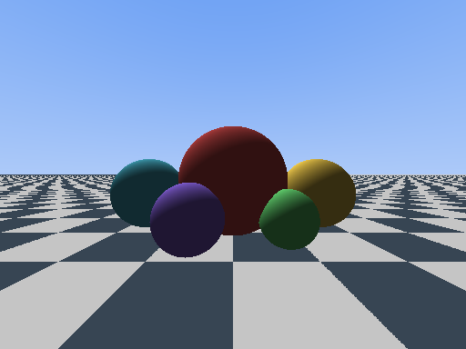

# NIL Framework

NIL is an open-source programming language framework for systems and application
development. It brings together **Ny**, with its compact systems syntax, and
**Matrix**, which expresses the same programming model in structured prose.
Both languages share a type system, standard library, and runtime. Programs
can run in the NIL virtual machine or compile to native code through LLVM.

This repository contains the compiler, runtime, standard library, debugger,
and editor tools for both languages.

[Documentation](docs/README.md) · [Getting started](docs/getting-started/index.md) ·
[Ny](ny/README.md) · [Matrix](matrix/MATRIX-GUIDE.md) ·
[Contributing](CONTRIBUTING.md)

[](https://ko-fi.com/execsoftware)

## Ny and Matrix

### Ny

Ny uses familiar function declarations, explicit types, and symbolic operators.
It combines records, classes, and generic programming with direct control over
pointers and allocation.

```ny
fn squared_length(x: i64, y: i64) -> i64
    return x * x + y * y
end fn

fn main() -> i32
    println(squared_length(3, 4))
    return 0
end fn
```

### Matrix

Matrix uses declarations that read as sentences, named arguments, and operators
written as words. Its grammar is designed for human readers and code-generating
agents, with explicit types and direct control over memory.

```matrix
book example

squared-length receives x as number, y as number returns number begin paragraph
    give x times x plus y times y
end paragraph

main returns override integer begin paragraph
    say squared-length with x being 3, y being 4
    give 0
end paragraph
```

Both programs print `25`. Save the Ny example as `example.ny`, or the Matrix
example as `example.matrix`. Matrix also accepts the `.mat` extension.

The [Ny language reference](docs/language-reference/types.md) and
[Matrix guide](matrix/MATRIX-GUIDE.md) cover the syntax and programming model.
The [Matrix design notes](matrix/README.md) explain the rationale behind its
grammar.

## The framework

Ny and Matrix compile through a shared semantic core to **NIL**, a stack-based
intermediate representation. The interpreter executes NIL directly; the native
backend lowers it through LLVM. A common module system lets programs in either
language use libraries written in the other.

The framework includes:

- **Systems programming facilities.** Typed scalar and bitwise operations,
  raw pointers, managed values, checked local ownership of scalar buffers,
  typed faults, and bounded parallel execution.
- **Shared language features.** Structural tuples provide typed multiple
  results and local destructuring. Explicit string interpolation supports
  expressions with consistent scalar formatting across execution routes, including
  multiline blocks. [Structured markup](docs/standard-library/markup.md) keeps
  generated HTML and its conditionals in one checked document, with context-specific
  escaping and document composition in both Ny and Matrix.
  [Collected queries](docs/standard-library/queries.md) compose filtering, stable
  ordering and projection. [Text patterns](docs/standard-library/text-patterns.md)
  offer readable declarations, bounded regex matching with named captures,
  splitting and literal replacement.
- **A shared standard library.** `nil.std.*` provides collections, text,
  mathematics, binary I/O, diagnostics, and reflection, alongside SQLite and
  PostgreSQL access. [NILData](docs/standard-library/nildata.md) provides
  structured data with prose-style blocks, exact numeric values, one array type
  and checked JSON interchange. Existing `ny.lang.*` imports remain aliases.
- **Interpreted and native execution.** The toolchain supports NIL
  interpretation, LLVM JIT and ahead-of-time compilation, and separate
  assembly and linking through `nilassembler` and `nillinker`.
- **Program analysis and debugging.** Structured diagnostics, declaration
  metadata, and source debugging provide a common basis for editor support
  and analyzers written in Ny or Matrix.
- **Opt-in runtime control.** Local AI/tool connections can pause, step and
  inspect the interpreter. Restricted deterministic VM programs support reusable
  same-process execution checkpoints. External-state rollback and code hot
  reload remain unsupported; see the [control contract](docs/design/NIL-0006-ai-module.md).
- **Project tooling.** `nilbuild` shares project settings and default analyzer
  rules with VS Code, and checks applications before VM or native builds.
  Live editor analysis includes unsaved source dependencies through a shared
  workspace snapshot. Compiler-resolved source bindings support Go to Definition
  for local variables, parameters and imported functions across both languages.
  Certified local variables also support references and checked rename.
- **Tests beside code.** `niltest` discovers compiler-checked test declarations,
  annotated functions, and suites in Ny and Matrix. Inline test regions can
  check a function's local state. Cases run in isolated VM or native processes
  and appear in VS Code's Test Explorer. See the
  [testing guide](docs/tools/testing.md).
- **Desktop applications.** The Matrix-authored
  [`nil.std.ui`](docs/standard-library/ui.md) provides windows, layout containers,
  standard controls, typed events, and explicit model synchronization. VM and
  native desktop checks pass with GTK4 on Linux, Win32 on Windows and AppKit on
  Intel and Apple Silicon macOS. Linux requires an external GTK4 runtime;
  desktop tests require an interactive session. Installed SDK and release
  qualification remain separate from these development checks.
- **Aperture runtime diagnostics.** Memory profiles record runtime allocations,
  frees, retained storage, peaks and source locations for VM and native programs.
  Saved JSON reports support inspection and automated analysis. See
  [aperture/README.md](aperture/README.md) for coverage and planned capabilities.

See the [standard-library reference](docs/standard-library/index.md),
[analysis API](docs/analysis-api.md), and [tool reference](docs/tools/index.md)
for available APIs and commands. The [NIL format documentation](docs/advanced/nil-format.md)
describes executable artifacts and the current library import model.

## Getting started

### Build the SDK

Building on Linux requires a C++17 compiler, CMake 3.21 or later, Python 3.12 or
later, LLVM development packages, and Pandoc. The
[setup guide](docs/getting-started/index.md) lists platform dependencies and
options for database support and builds without LLVM.

```sh
git clone https://github.com/exec-software/exec-nil-framework.git
cd exec-nil-framework
CMAKE_BUILD_PARALLEL_LEVEL=4 CTEST_PARALLEL_LEVEL=4 ./scripts/build-sdk.sh
```

The build runs the test suite and creates an SDK in `sdk/`, including the
compiler, runtime tools, standard library, and HTML documentation. It expects
a clean checkout; see the setup guide for building with local changes.

### Compile and run

Compile the Matrix example to NIL and run it:

```sh
sdk/nilcompiler --no-bundle example.matrix -o example.nil
sdk/nilinterpreter example.nil
```

Or compile it to a native executable:

```sh
sdk/nilcompiler --native example.matrix -o example-native
./example-native
```

Use `example.ny` in the same commands to compile the Ny version. Native linking
uses the host C++ toolchain and the SDK's runtime library.

To check a program and emit structured diagnostics:

```sh
sdk/nilcompiler --analyze example.matrix
```

### Visual Studio Code

The [VS Code extension](vscode/README.md) supports both languages with syntax
highlighting, completion, compiler diagnostics, quick fixes, build tasks, and
source debugging. Follow its installation instructions, then set `ny.sdkPath`
to the SDK directory. The extension also discovers `sdk/` when working in this
repository. Compiler-backed completion includes visible locals, imported functions
and supported receiver members. Signature help follows resolved call parameters,
including Matrix named arguments. Definition navigation follows
checked bindings across both languages; references and rename are available for
locals whose complete occurrence sets the compiler can certify.

For projects with multiple source modules, add a
[`nil.project.nildata`](docs/tools/projects.md) manifest. Project check, build and
run commands use the same import paths and analyzer policy as live checks.

### Tests beside the code

[`niltest`](docs/tools/testing.md) discovers named tests and annotated test
functions in Ny and Matrix, then runs each case in an isolated process through
the interpreter, native code, or both. Inline test blocks share their enclosing
function's locals and run when a test calls that function. Ordinary builds omit
test-only code. `nilbuild test` uses the project configuration, and the VS Code
Test Explorer offers interpreter and native run profiles.

```sh
sdk/niltest run --target all example.matrix
```

## Examples

[`validation/ny-3d`](validation/ny-3d) is an independent consumer of the SDK:
three CPU 3D renderers written in Ny, driven by a Python harness that checks
each execution route against an independently written reference. The sphere
scene is compared pixel for pixel against a float64 oracle, including per-row
hashes, so a pass means the Ny program and the oracle agree exactly.



The indexed mesh renderer rasterizes triangles into raw depth buffers:



The third renderer is an animated scene player with reused buffers and an
atomic binary checkpoint. It currently disagrees with its own oracle on both
routes, while the first two agree exactly. That is tracked as a
[known finding](validation/ny-3d/README.md#known-finding-scene-player-disagrees-with-its-oracle),
not a passing case, so `--quick` exits nonzero on four passes and two failures.

Build the SDK, then run the matrix from that directory:

```bash
cd validation/ny-3d
python3 scripts/validate.py --quick
```

The harness covers eight routes — textual and binary NIL through the
interpreter, bundled executables, LLVM JIT, native ahead-of-time, and
assembler/linker — verifies the SDK payload against its sealed manifest before
and after every run, and refuses to execute an SDK that changed underneath it.

[`validation/matrix-3d`](validation/matrix-3d) is the same discipline applied
to a single raytracer written in **Matrix**. It checks every route twice —
against an independent float64 oracle and against every other route — so a pass
means the interpreted and LLVM backends produce byte-identical images that also
match the reference exactly. All eight routes currently do.



It also turned up a real defect: numeric-to-text casts (`say (5 becomes text)`)
compile on all four interpreted routes but are rejected by the LLVM native
backend. The renderer works around it and the
[README](validation/matrix-3d/README.md#known-limitation-number-to-text-casts-on-native-routes)
records the reproduction. For portable scalar formatting, use explicit
[formatted interpolation](docs/language-reference/expressions.md#formatted-text),
such as `say formatted "value={5}"`; it works on interpreted and native routes.

## Project status

Current hardening adds lexical Matrix name resolution and completion,
[definite-assignment diagnostics](docs/language-reference/statements.md#definite-assignment),
and [real collection reservation, a ring queue and bucketed HashMap](docs/standard-library/index.md#collection-storage-and-lookup).
Native arrays now support exact declared non-class records, enum/choice values,
and nested arrays with finite, supported schemas, including concrete generics.
Class arrays preserve checked ancestor views and virtual dispatch; arrays of
`ref<Record>` or `ref<Class>` preserve exact shared-reference identity. Recursive
nominal schemas can be constructed through initialized handles, empty arrays
and terminating enum variants; required fields still need initialization.
Record elements retain shared mutable identity; enum values retain their variant
and payload, including contained aliases. Nested arrays share child handles and
can be jagged. Invalid or uninitialized tuple, record, enum and nested-array reads
fail because these types have no default value. Focused collection coverage
includes record-key HashMap, record queues, and native HashSet/Dictionary copies.
`f32` arrays, binary networking, callbacks and platform SDK qualification remain
separate work. The [notebook](notebook/2026-11-26-language-library-hardening.md) records
validation and the remaining sequence before mainline consolidation.

The current version is **1.0.0-rc.1**. Development coverage spans Linux x86_64,
Windows x86_64, Intel macOS and Apple Silicon macOS. The earlier platform
qualification campaign verified relocated development SDKs on all four hosts:
1,184 installed standard-library routes, twelve PostgreSQL source/binary routes,
146 debugger checks and same-process execution checkpoints. Its Linux SDK also
passed all 590 source tests, twenty installed GTK desktop/input cases and all 88
real VS Code host groups without exclusions. The newer Goetic/Enigma integration
results are recorded separately below.

Windows uses Win32 and macOS uses AppKit. Windows and both Mac architectures
also pass twenty installed desktop/input cases, four desktop debugger sessions
and all 88 editor groups. Both Macs pass the expanded application campaign and
native incremental reuse. An earlier Intel installed-editor timeout passed a
diagnostic rerun within the unchanged deadline; its cause remains unconfirmed
and the failed report is retained. A separate Windows account exposed a
packaged-library permission defect; the correction passes real cross-account
access tests.

The socket, arbitrary random-byte and bytes-to-text APIs pass the same
interpreter contracts on every host; these APIs currently require the
interpreter on all platforms.
File timestamps also pass textual/binary NIL, LLVM JIT and AOT checks everywhere.
The [platform support matrix](docs/platform-support.md) records exact SDK/source
revisions, retained failures and remaining deployment boundaries.

The [current framework integration](https://github.com/exec-software/exec-nil-framework/pull/41)
combines rooted file snapshots, the Matrix WebView bridge and the completed
formatted-text/markup work. Its [qualification record](notebook/2026-11-13-formatted-markup-handoff.md#current-framework-integration)
tracks current-source checks separately from the installed SDK results above.

The [Goetic/Enigma integration](https://github.com/exec-software/exec-nil-framework/pull/43)
additionally combines those compiler and editor
fixes with [durable files and context-owned locks](docs/standard-library/durable-files.md),
private-entry checks, SHA-256, optional console input and native hexadecimal
random draws. The source also implements Windows private entries and context-owned
locks; Windows durable writes and directory synchronization require local NTFS.
The `b564ef6` Windows development SDK passes 609 source tests, with two headless
display skips, all 1,248 installed ordinary routes, and the installed durable,
console and global-state checks. The [Windows qualification record](notebook/2026-11-21-windows-durable-parity.md)
pins the SDK and later qualification helper separately. Desktop acceptance and
stable-release qualification remain separate. The
[integration notebook](notebook/2026-11-21-goetic-enigma-sdk.md) separates source
checks, installed SDK evidence and remaining limitations.
The interpreter also preserves imported class values through typed module
globals, record wrappers and explicit `Option<Class>` factories. Native
aggregate globals remain unsupported. The real Goetic/Enigma snapshot and
optional-value consumers pass against the relocated Linux development SDK.
The earlier `167ae3a` Linux development SDK campaign passed 609 source tests and
1,248 installed artifact routes; its four-host campaign passed 18 interpreter
contracts and 32 fixture routes per host. Admission indexing reduces the measured Goetic parse/load time
from 45.58 seconds to 0.45 seconds. With the updated SDK, an isolated Goetic
instance reached HTTP readiness in 0.56 seconds within its unchanged ten-second
deadline. Its complete application suite passes all 26 Matrix fixtures and 101
HTTP tests; canonical SDK relocation also passes. The notebook records the
exact source and SDK identities and separately tracks hosted application checks.

These are development results. Windows and macOS release qualification remains
pending. The
[release profile](docs/release/v1-profile.md) defines supported configurations
and release requirements. Known limitations and planned improvements are
tracked in the [development findings](matrix/docs/next-version-findings.md).

## Contributing

NIL is developed by Execute Software and its [contributors](CONTRIBUTORS.md).
Community contributions are welcome across the languages, compiler, runtime,
standard library, documentation, and developer tools.

Start with [CONTRIBUTING.md](CONTRIBUTING.md) for the build and test workflow.
Use the [issue tracker](https://github.com/exec-software/exec-nil-framework/issues)
to report bugs or propose changes. Bug reports should include a small program
that reproduces the problem and the commands used to build or run it.

Architectural decisions are recorded in the [design index](docs/design/README.md):
`NIL-` for the shared framework, `NY-` for Ny, and `MAT-` for Matrix.

## Support our work

Execute Software develops these projects in the open, and they stay free to
use. If one of them has been useful to you, a contribution helps fund the time
that goes into it. It is entirely optional, and it does not change what the
project gives you or what the license permits.

[Support us on Ko-fi](https://ko-fi.com/execsoftware).

For enterprise licensing and support, contact
[admin@executesoftware.com](mailto:admin@executesoftware.com).

## License

NIL Framework is licensed under the [MIT License](LICENSE).

Copyright (C) 2008 - 2026 Execute Software.  All rights reserved.

Third-party components retain their own licenses. See the
[toolchain notices](release/THIRD_PARTY_NOTICES.txt) and
[extension notices](vscode/THIRD_PARTY_NOTICES.txt).
