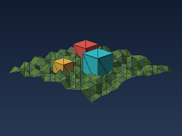

# Ny 3D Validation

An independent consumer project for finding Ny v1 gaps with three CPU 3D
renderers and pointer-heavy buffer operations. The renderers compute their
images in Ny. Python drives the installed commands, checks their outputs, and
supplies independent reference calculations.

The upstream copy of this project also carries roughly 130 focused language and
standard-library probes with expected outputs. This version keeps the three
renderers, the harness and the independent oracles, which are the parts that
exercise the toolchain end to end.

## SDK

The project consumes the SDK built at the repository root:

```bash
./scripts/build-sdk.sh          # from the repository root
cd validation/ny-3d
python3 scripts/validate.py
```

Point `NIL_SDK` at a different build to test one explicitly:

```bash
NIL_SDK=/path/to/other/sdk python3 scripts/validate.py
```

The harness verifies the SDK payload against its sealed `manifest.json` before
and after every run and refuses to execute an SDK that changed underneath it.
Results stay tied to the build that produced them, so capture a separate
baseline when testing a newer SDK rather than replacing a build mid-investigation.

## Requirements

- Linux x86_64 compatible with the SDK's host libraries.
- Python 3.10 or newer for the validation harness; no pip dependencies.
- A host C++ compiler driver for native linking (this SDK uses `/usr/bin/c++`).

LLVM headers, CMake, and an installed editor extension are not needed to
consume the SDK.

## Validate

From this project directory:

```bash
python3 scripts/validate.py
```

The runner verifies the SDK before and after execution, retains command logs
and generated artifacts, checks exact expected probe outputs, and compares
rendered images across these routes:

| Route | Pipeline |
| --- | --- |
| `nil-text` | Source → textual NIL → interpreter |
| `nil-binary` | Source → binary NIL → interpreter |
| `bundle-text` | Source → bundled textual NIL executable |
| `bundle-binary` | Source → bundled binary NIL executable |
| `jit` | Source → LLVM JIT |
| `aot` | Source → native executable |
| `assemble-text` | Source → textual NIL → assembler → linker → executable |
| `assemble-binary` | Source → binary NIL → assembler → linker → executable |

Use `python3 scripts/validate.py --help` for route and workload controls.
Reports distinguish successful execution, expected rejection, documented
unsupported capabilities, and unexpected failures. A rejected program never
counts as successful feature execution.

Useful smaller or larger runs:

```bash
# Interpreter and native compilation for rapid iteration.
python3 scripts/validate.py --quick

# Repeated larger ray-traced renders, with exact route and reference checks.
python3 scripts/validate.py --only renderer --routes nil-text,aot \
  --width 512 --height 384 --stress 2 --report reports/stress.json

# Indexed mesh, array growth, triangle rasterization, and raw depth buffers.
python3 scripts/validate.py --only mesh-renderer --routes nil-text,aot \
  --width 512 --height 384 --stress 2 --report reports/mesh-stress.json

# 120 frames inside each process, with reused buffers and binary checkpointing.
python3 scripts/validate.py --only scene-player --routes nil-text,aot \
  --width 256 --height 192 --frames 120 --timeout 120 \
  --report reports/scene-stress.json

# Optional Linux file-access audit; requires strace.
python3 scripts/check_isolation.py
```

`scripts/validate_debugger.py` and `scripts/audit_diagnostics.py` additionally
require the optional `probes/` corpus (debugger and diagnostic fixtures), which
is not published with this repository. Without it, `validate.py --quick`
exercises the three renderers and is the whole published matrix.

`reports/validation.json` and its `.txt` companion contain the full matrix.
Each case retains its source hash, commands, exit status, stdout/stderr and
generated artifacts under `work/runs/`. Renderer rows point to both PPM and PNG
images. `reports/stress.json`, `reports/mesh-stress.json`, and
`reports/scene-stress.json` record the larger workloads. `reports/scene.png`
and `reports/mesh-scene.png` are the 512×384 static previews; the scene player's
latest frame is in `reports/scene-player.png`. `--stress` repeats whole
processes; `--frames` advances the scene inside each scene-player process while
reusing the same raw buffers. Neither is a measured leak test. The pointer
soak separately performs allocation/free cycles inside one process.

Every scene-player invocation replaces an invalid checkpoint sentinel. The
harness retains each produced checkpoint and checks its bytes against an
independent reference, so a repeat cannot pass using a stale file. All frame
digests/fragments are checked; the emitted final frame receives a complete
pixel comparison. [SCENE_PIPELINE.md](SCENE_PIPELINE.md) specifies the workload
and binary layout.

`reports/debugger.json` and protocol transcripts under `work/debugger/` record
breakpoints, conditional stops, stepping, frames/locals, output, restart, and
pause/termination checks. This tests the SDK's JSONL/DAP interfaces; native
executable debugging and editor UI integration are separate capabilities.

The complete matrix exits nonzero while confirmed SDK defects and native
capability gaps remain. Expected correct behavior stays in each fixture; a
known issue is not an expected-failure exemption. See [FINDINGS.md](FINDINGS.md)
for the current baseline.

`baseline.json` records the latest complete phase. `baselines/phase-01.json`
and `baselines/phase-02.json`, with their archived reports, preserve earlier
measurements. `reports/phase-02/source.tar.gz` retains the consumer sources
before the shared-mesh refactor.

## Known finding: scene-player disagrees with its oracle

`--quick` runs six cases (three renderers × interpreter and native AOT). Four
pass. `scene-player` fails on both routes because its final frame and its
`scene-state.bin` checkpoint disagree with the independent Python oracle in
[`scripts/check_scene_player.py`](scripts/check_scene_player.py).

This is an open finding, not a flaky check:

- **It is not a route divergence.** `nil-text` and `aot` emit byte-identical
  PPM and `scene-state.bin`, so the interpreter and the LLVM native backend
  agree exactly with each other.
- **It is not a whole-project failure.** `renderer` and `mesh-renderer` pass
  their oracles exactly, including per-row hashes.
- **The disagreement is structural, not rounding.** Depth-passing fragments
  are 91–252 per frame where the oracle expects roughly 1096–1392, and 870 of
  4800 pixels differ. The checkpoint diverges first at offset 32, the
  `final_digest` header field, with length and stored CRC32 still self
  consistent.
- **The animation formulas already agree.** Terrain and tower motion in
  `src/scene_player.ny` match `frame_vertices()` in the oracle line for line,
  so the remaining drift is elsewhere in the rasterization or scene setup.

Here is the final frame it produces at 80×60, for comparison against what the
oracle expects:



Because this is a confirmed disagreement rather than an unavailable
capability, it is not an expected-failure exemption: the matrix still exits
nonzero, and `reports/validation.json` records it as `FAIL`. Resolving it means
deciding which of the two is authoritative — the Ny scene or the oracle.

## What this project is intended to reveal

The ray tracer exercises floating-point geometry alongside manually allocated
scene, pixel, packed-color, and row-checksum buffers. Focused probes isolate pointer stride,
aliasing, dereference, release and invalid access; integer widths and bitwise
operators; allocation cycles; serialization; and higher-level language
features that a larger application needs.

The indexed renderer builds 313 vertices and 548 triangles for terrain and
three occluding towers. Arrays store vertex components, triangle indices, and
packed materials; raw pointers store RGBA pixels, i64 depth, RGB bytes, and
row hashes. Integer projection, barycentric coverage, normals, depth ties,
material flags, and every output pixel are checked by a separate Python
implementation. Parallel scalar arrays keep this workload within the copied
SDK's native array subset; dedicated probes expose aggregate/nested array and
collection limits. Mesh indices are generated internally, not loaded from
untrusted files.

The scene player imports that same mesh/raster module, copies base coordinates
explicitly because array assignment aliases storage, and animates terrain and
towers for up to 120 frames. Towers now move through a **recursive scene graph**
(`src/scene/scene_graph.ny`): a root node binds the terrain and three
tower-group nodes are children of the root, each with a tower node child.
Because recursive struct *types* fail closed in the native backend, the
hierarchy is stored as parallel scalar arrays and traversed by recursive
functions, keeping it inside the verified native array subset; the graph is
re-traversed every frame. The player serializes final geometry and per-frame
telemetry using the STL's little-endian byte routines, writes atomically,
reads with a size limit, and validates decoded values and CRC32. This is a
save-and-verify workload; loading a checkpoint to resume a new process remains
future work.

This is a broad, reproducible validation workload, not exhaustive proof of
every language feature or standard-library API. In particular, a CPU renderer
does not qualify GPU APIs, a native window/event loop, arbitrary foreign ABIs,
cross-platform execution, or undocumented unsafe memory behavior. Coverage and
findings should determine the next compiler/library work, rather than being
hidden by edits to the SDK under test.

This matrix imports `sdk/nilstd` sources. Application binary NIL coverage
does not establish compiled-library (`sdk/nillib`) import coverage. Editor/LSP
UI behavior, database/network providers, and unmanaged execution are also
outside the measured matrix. Debugger protocol coverage has its own report.

## Project layout

```text
src/                 Ray tracer, indexed renderer, and persistent scene player
src/scene/           Shared geometry and rasterization module
scripts/             Consumer harness and independent reference checks
baselines/           Preserved summaries from prior validation phases
images/              Rendered previews used by the repository README
reports/             Measured results (generated, not committed)
work/                Build artifacts, logs, and minimal reproductions (generated)
```
